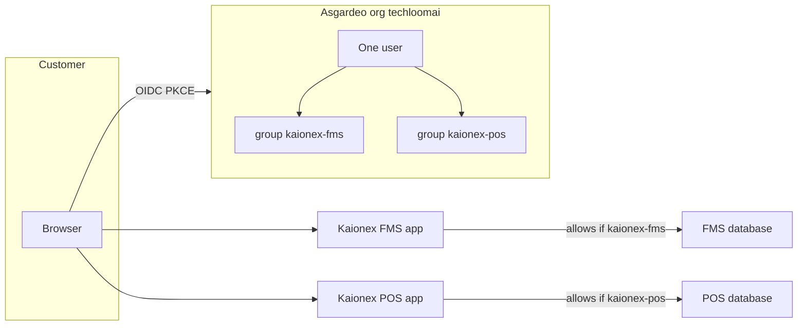

# One login for KAIONEX POS and FMS

Research paper for Techloom. Organization: `techloomai`.
Console: https://console.asgardeo.io/t/techloomai/app/getting-started

This paper lists every practical way to give a customer one email and one password for Point of Sale (POS) and Finance Management System (FMS), then how each product decides what that person is allowed to do. FMS in this zip already follows the login design. POS is not in this zip and is not built here.

The shorter operator note is `docs/KAIONEX_POS_FMS_ASGARDEO_LOGIN.md`.

## 1. Question

A customer buys one Kaionex product. Techloom sends one email and one password. Later Techloom gives that same customer the other product. They must keep the same login. Techloom must not create a second user and must not send a second password.

POS and FMS stay separate products. Sales and stock stay in POS. Companies, departments, budgets, and transactions stay in FMS. Sharing a login does not merge those databases.

## 2. What FMS is today

This repository is the FMS zip, not the company main repository. The app is React and Vite. Business data is in Supabase Postgres. Login for staff is not Supabase Auth and not OpenID Connect. `src/App.jsx` checks a bcrypt password in this order: `admin_accounts`, then `departments`, then `company_profiles`, then `company_users`.

Those four logins stay. They are people inside a finance workspace. The Asgardeo user is the customer Techloom sold a product to.

FMS already has a second path, **Continue with Asgardeo**, using `@asgardeo/react`. It is Authorization Code with PKCE. The browser does not hold a client secret. Tokens stay in the SDK `sessionStorage`. The button does nothing until `VITE_ASGARDEO_CLIENT_ID` is set, because this zip has no invented client ID.

After Asgardeo returns, FMS allows the session only when the ID token contains `kaionex-fms`. `kaionex-pos` alone, or no groups, opens `/unauthorized` and does not create an FMS session. A matching `admin_accounts` row is reused by email and its password is not changed. If no row exists, FMS inserts one with a random unusable hash so the existing admin screens still have a row. The Asgardeo password is never written to Supabase.

## 3. Requirements both products must meet

1. One customer is one person, one email, one password.
2. Buying the second product adds access. It does not add a user.
3. FMS opens only for `kaionex-fms`. POS opens only for `kaionex-pos`. Both groups mean both products.
4. A person with no product group opens neither product.
5. Each product keeps its own database and its own staff passwords.
6. The React apps are public clients. No client secret in frontend code, in `VITE_` variables, or in git.
7. A password change happens once, in Asgardeo, and then works for every product that customer owns.
8. Removing a group closes that product on the next sign-in. It does not delete the other product’s business data.

## 4. The ways this can be done

### Way A — Second user for the second product

Create `customer@shop.com` in FMS and another `customer@shop.com` in POS, or two Asgardeo users. Each product has its own password.

This is the current habit the project is leaving. The customer must remember two logins. A password reset in one product does not fix the other. It fails requirement 1.

**Do not use this.**

### Way B — Copy the same password into both databases

Techloom types the same email and the same bcrypt hash into the FMS user table and the POS user table.

The customer can type the same password in both apps, but the apps do not share a session. Changing the password means updating two databases. If one update fails, the passwords drift. POS and FMS must both be online for a reset. Neither app can trust the other app’s table.

**Do not use this.** It looks like one login and behaves like two.

### Way C — One shared user table that both apps read

Put customers in one Postgres table. FMS and POS both connect to it for sign-in, and keep their business tables elsewhere.

This can work if both codebases can reach that database and both agree on the password code. It ties release schedules together. A column change for POS can break FMS login. It also keeps passwords inside Techloom’s database, which is the thing Asgardeo is there to remove. Staff rows and customer rows would still need a careful split.

**Possible, not chosen.** Use it only if Asgardeo is rejected.

### Way D — Supabase Auth as the shared identity

Turn on Supabase Auth in one project. Both products use that project’s URL and anon key. Product access is stored in `app_metadata` or a `product_access` table.

FMS does not use Supabase Auth today. Moving it means replacing the bcrypt table login, the session helper, and password reset. POS may not use Supabase at all. Supabase Auth can be a good shared identity for two apps on the same project. It is a different product from the Asgardeo organization `techloomai` that Techloom already opened.

**Possible later for a Supabase-only estate. Not this project.** The console already chosen is Asgardeo.

### Way E — One Asgardeo user, two applications, two groups

This is the design to implement in both products.



Techloom creates the person once in Asgardeo. The first product adds one group. The second product adds the other group to that same user. Each product is its own single-page application with its own client ID, redirect URL, and logout URL. Each app asks Asgardeo for an ID token and reads groups. FMS checks `kaionex-fms`. POS checks `kaionex-pos`.

The password lives only in Asgardeo. FMS already links the email to `admin_accounts` without storing that password. POS must link the same email to its own user or store record the same way, in the POS database, not in FMS tables.

**Chosen.** FMS code is in place. POS must follow the same rule with its own client ID and its own group check.

### Way F — One Asgardeo application for both products

Register a single application and add both redirect URLs: the FMS origin and the POS origin. Both apps share one client ID. Groups still decide which product opens.

Fewer console objects. Weaker boundary. A redirect-URL mistake on one product affects the other. Disabling the application disables both products. The client ID would be copied into two repositories. Auditing “which product signed in” is harder because the client is the same.

**Acceptable only as a short experiment.** Production should use Way E, two applications in the same organization.

### Way G — Roles inside one application, instead of groups

Asgardeo can also express access with roles or with application-scoped permissions. The check in code is the same shape: read a claim, allow or deny.

Groups match the business sentence better. “This person belongs to the FMS buyers” and “this person belongs to the POS buyers” are memberships, and one person can have both. Roles inside FMS already mean something else: admin, company, department, company user. Those FMS roles must not be confused with Asgardeo groups.

**Use groups for product access.** Keep FMS staff roles in the FMS database.

### Way H — A company organization per customer

Asgardeo can model a business customer as an organization, with the buyer as an admin who invites cashiers and accountants.

That fits a later phase, when one shop has many staff who should sign in with their own emails. It is too large for the first release. The first release is one buyer, one email, one password, and a group per product. Staff who already have FMS passwords keep those passwords.

**Later, not now.**

### Way I — SAML instead of OpenID Connect

SAML is a common enterprise login. Both products would be SAML service providers and Asgardeo would be the identity provider.

The Kaionex apps are React single-page apps. OpenID Connect with PKCE is the flow built for that. SAML needs more server-side XML handling and does not give a simpler group story. The installed SDK is `@asgardeo/react`, which speaks OpenID Connect.

**Do not use SAML for these two apps.**

### Way J — A Techloom backend that issues its own tokens

FMS and POS would send the email and password to a Techloom API. That API checks Asgardeo, or its own user table, and returns a Techloom JWT. Both apps trust that JWT.

This is useful when a secret must stay on a server, or when many mobile clients need one token format. It adds a service that both products must call, and it puts password handling back in Techloom code. The public single-page apps can talk to Asgardeo directly with PKCE, so the extra service is not required for login.

**Not required for v1.** Revisit if a mobile app cannot use the browser flow.

### Way K — Provision the product record before the first login

Way E creates the FMS `admin_accounts` row on the first successful Asgardeo login if the email is new. That is just-in-time linking. The other choice is to create the FMS row and the POS store row at the moment Techloom adds the group, before the customer signs in. Asgardeo can push that with SCIM or a webhook. An operator can also create the row by hand.

Just-in-time is already how FMS works, and it is enough to open the app. Creating the business record earlier is better when the sale must attach a company, a shop, or a plan before the customer arrives. Those are product records, not a second login.

**Use just-in-time for the login row. Create shops, companies, and plans in each product when the sale happens.** Do not wait for SCIM to make the password work.

### Way L — Shared cookie on a Kaionex parent domain

If FMS is `fms.kaionex.app` and POS is `pos.kaionex.app`, a cookie on `.kaionex.app` could remember a Techloom session.

Browsers are restricting third-party and parent-domain cookies. Two apps on two origins do not share `localStorage`. The reliable shared session is the Asgardeo session on `api.asgardeo.io`, which both apps already redirect to. After the customer signs in once, the second app’s authorize request can complete without another password while that Asgardeo browser session is still valid. Each app still stores its own tokens on its own origin.

**Do not invent a parent-domain cookie.** Rely on the Asgardeo browser session for the second product.

## 5. Comparison

| Way | One password | Second product adds a group, not a user | Products stay separate | Fits the current FMS code | Decision |
| --- | --- | --- | --- | --- | --- |
| A. Second user | No | No | Yes | No | Reject |
| B. Copied password | Only until they drift | No | Yes | No | Reject |
| C. Shared user table | Yes | No, it shares a row | Weak | No | Hold |
| D. Supabase Auth | Yes | Possible | Only if both use one project | No | Not this project |
| E. Two Asgardeo apps, two groups | Yes | Yes | Yes | Yes | Use |
| F. One Asgardeo app, two redirects | Yes | Yes | Weak | Possible | Experiment only |
| G. Roles instead of groups | Yes | Yes | Yes | Would mix with FMS roles | Use groups |
| H. Organization per customer | Yes | More than v1 needs | Yes | No | Later |
| I. SAML | Yes | Yes | Yes | No | Reject |
| J. Techloom-issued JWT | Yes | Yes | Needs a new API | No | Not for v1 |
| K. Pre-create business rows | Yes, with Way E | Yes | Yes | Login row is already just-in-time | Add when a sale needs a shop or company first |
| L. Parent-domain cookie | Unreliable | — | — | No | Reject |

## 6. Design both products implement

One organization, `techloomai`. One user per customer. Two applications.

| | FMS | POS |
| --- | --- | --- |
| Application | Kaionex FMS | Kaionex POS |
| Protocol | OpenID Connect, Authorization Code + PKCE | Same |
| Client secret in the app | None | None |
| SDK | `@asgardeo/react` | Same major line |
| Base URL | `https://api.asgardeo.io/t/techloomai` | Same |
| Scopes | `openid profile email groups` | Same |
| Allow claim | `kaionex-fms` | `kaionex-pos` |
| Deny | missing `kaionex-fms` | missing `kaionex-pos` |
| Local database | Supabase tables already in FMS | POS database, untouched by FMS |
| Link key | email | email |
| Staff passwords | Stay in FMS tables | Stay in POS, if POS has them |

Group values may arrive as `kaionex-fms` or as a path ending in `/kaionex-fms`. FMS treats both as a match, and also reads `groups`, `roles`, `group`, and the WSO2 claim URIs `http://wso2.org/claims/groups`, `roles`, and `role`. POS should copy that reader instead of assuming one claim name. The first real ID token from `techloomai` must be inspected. If the group is under a new claim name, add that name in both apps.

Email is read from `email`, then `preferred_username`, `username`, or `upn`, and stored in lower case.

### What the customer experiences

1. Techloom creates the Asgardeo user and adds `kaionex-fms` or `kaionex-pos`.
2. The customer opens that product and chooses Continue with Asgardeo.
3. Asgardeo asks for the one email and password.
4. The product checks its own group. The other product is not installed in this step.
5. When Techloom adds the second group, the customer opens the second product. Asgardeo recognizes the browser session and can skip the password. The second product still checks its own group and still loads its own data.
6. Sign-out in one product should end the Asgardeo session if the product calls `signOut`, so the other product is not left quietly signed in on a shared computer. FMS does this for Asgardeo sessions.

### What each codebase must keep separate

- FMS must not write POS sales, and POS must not write FMS transactions.
- FMS must not convert `company_profiles`, `departments`, or `company_users` into Asgardeo users.
- POS must not import the FMS `admin_accounts` table to make login work.
- Neither app stores the Asgardeo password.
- Neither app puts the access token in `localStorage` by hand. The SDK `sessionStorage` is the token store used in FMS. POS should match it.

## 7. Authorization

Authentication answers who the person is. Authorization answers what they may open and what they may change. Asgardeo does the first. Product groups do the second only at the door. Screens and rows inside FMS or POS are a separate decision, and they stay in that product.

```text
Asgardeo proves the email and password
        |
        v
Product check: kaionex-fms or kaionex-pos
        |
        +-- missing --> unauthorized, stop
        |
        v
Local role + data scope inside that product only
        |
        v
Screens and rows that role is allowed to see
```

### Two decisions that must not be mixed

| Decision | Question | Where it lives | Example |
| --- | --- | --- | --- |
| Product entitlement | May this person open this product? | Asgardeo group | `kaionex-fms`, `kaionex-pos` |
| Product role | Once inside, what may they do, and for which shop or company? | That product’s database | FMS `admin`, `company`, `department`, `company_user` |

A group is not a role. `kaionex-fms` means the customer bought Finance. It does not mean they are the Techloom operator, a company owner, a branch, or a staff member. `kaionex-pos` means they bought POS. It does not mean cashier or store manager.

### What FMS already authorizes

FMS does not have a separate permission table. `src/App.jsx` and `src/AppDashboard.jsx` branch on `authUser.role` and, for staff, `sub_role`.

| Local role | Who it is | What the code allows |
| --- | --- | --- |
| `admin` | Row in `admin_accounts` | All departments, company list, categories, approve entries, create department logins |
| `company` | Row in `company_profiles` | That company’s departments and finance data |
| `department` | Row in `departments` | That branch only |
| `company_user` | Row in `company_users` | That company’s data. `sub_role` `manager` with a `department_id` is limited to that department |

Deleting an entry asks for a password again. An admin confirms with the login password. A company or department confirms with the delete password stored for that account. That check is FMS authorization. Asgardeo does not replace it.

Company and department users sign in with the password form. They never need an Asgardeo group. Their authorization is unchanged.

### What the current Asgardeo link does

`src/auth/linkCustomer.js` returns `role: 'admin'` for every allowed Asgardeo email, because it reuses or creates `admin_accounts`. After `kaionex-fms` matches, the customer is authorized as the FMS operator: every company and every department.

That is acceptable for a single operator on this zip. It is too wide when many customers share one FMS deployment. A shop that bought FMS would see other shops.

**Research decision for authorization**

| Phase | Who signs in with Asgardeo | Local role |
| --- | --- | --- |
| This zip, one operator | The Techloom or pilot admin | `admin`, as the code does now |
| Many customers on one FMS | The buyer | `company`, and only after a `company_profiles` row exists for that email |
| Staff the buyer creates | Password form, not Asgardeo | `department` or `company_user`, scoped to that company |

Do not promote every Asgardeo user to `admin` once more than one customer uses the same database. The product group still only opens FMS. The company row decides which transactions they see. If the email has `kaionex-fms` but no company row yet, FMS should open a setup screen, not the all-companies dashboard. That setup screen is not built in this zip.

POS is not in this zip, so POS role names are a proposal, not a fact. The same split applies: `kaionex-pos` opens POS; a local role such as owner, manager, or cashier, plus a store id, decides the register and the stock. Those rows live in the POS database.

### Ways to authorize, and which one to use

**Way 1 — Group at the door, role in the product. Use this.**

Asgardeo releases `groups`. FMS allows the session only for `kaionex-fms`. POS allows it only for `kaionex-pos`. Each app then loads its own role and scope. Revoking a product removes the group. Changing a cashier to a manager changes a POS row and does not touch the FMS role. This matches the code shape already in FMS.

**Way 2 — Encode every action as an Asgardeo group.**

Examples: `kaionex-fms-admin`, `kaionex-fms-company`, `kaionex-pos-cashier`. The token would carry the action as well as the product.

This fails the data scope. A group name cannot say which `company_profile_id` or which store the person may read. FMS would still need the local row. Two sources would then disagree. A person could be `kaionex-fms-company` in Asgardeo and `admin` in `admin_accounts`.

**Do not use action groups.**

**Way 3 — OAuth scopes as permissions.**

The authorize request already asks for `openid profile email groups`. Those scopes tell Asgardeo what claims to put on the token. They are not FMS permissions. Scopes such as `fms.read` or `pos.sell` would matter later, if a resource server checked the access token before returning JSON. This React app talks to Supabase with the publishable key. It does not send the Asgardeo access token to an API that enforces scopes.

Keep the four scopes. Do not invent action scopes until there is an API that rejects a token without them.

**Way 4 — Let the UI hide buttons and call that authorization.**

Hiding a menu item is not enough. The FMS checks in `App.jsx` run in the browser. The existing database script turns row level security off and grants the publishable key. Anyone who can call Supabase can read rows the screen would hide. This paper does not turn row level security on. Real authorization, beyond the door, needs the database or an API to repeat the same role and company checks. That is a separate project.

### Protocol authorization, in one place

The phrase “authorization” also names the OAuth step. Both apps use the Authorization Code flow with PKCE:

1. The app sends the user to Asgardeo with the client ID, redirect URL, scopes, and a code challenge.
2. Asgardeo authenticates the user and applies the user’s groups.
3. Asgardeo redirects back with a code. The app exchanges the code and the code verifier for an ID token and an access token.
4. There is no client secret in that exchange. `tokenRequest.authMethod` is `none`.

The ID token is the identity and the group list. The access token is not stored by hand and is not used as an FMS permission. Sign-out revokes the Asgardeo session.

### Rules for both products

1. Missing product group: no local session, even if a local row exists.
2. Present product group: local role still applies. The group does not raise the role to admin.
3. Staff created inside a product keep password login and the local role. They are not copied into Asgardeo for v1.
4. Removing `kaionex-fms` closes FMS. It does not delete companies or change POS.
5. A role change inside FMS does not add or remove `kaionex-pos`.
6. The first real ID token must be checked so the group claim name matches `src/auth/groups.js`. Authorization that reads the wrong claim denies every user.

## 8. Work already in this FMS zip

| Piece | Where | State |
| --- | --- | --- |
| Config, empty client ID returns “not configured” | `src/auth/asgardeoConfig.js` | Done |
| Group and email readers | `src/auth/groups.js` | Checked with sample claims, including path suffix and WSO2 URI |
| Link or reuse `admin_accounts` without changing a real password | `src/auth/linkCustomer.js` | Done |
| Provider around the app | `src/auth/AsgardeoRoot.jsx`, `src/main.jsx` | Done |
| Button and denied page | `src/components/Login.jsx`, `src/components/Unauthorized.jsx` | Button stays disabled until the client ID exists |
| Session rules | `src/App.jsx` | Asgardeo does not replace a company or department session unless the person clicked Continue with Asgardeo |
| Example env keys | `.env.example` | Client ID left empty |
| Package | `@asgardeo/react` | Installed. The older `@asgardeo/auth-react` package was removed |

Still blocked on a real client ID from the `techloomai` console. No live login against Asgardeo has been run. Password login for `admin@kaionex.com` still reaches the FMS dashboard.

Console settings for the FMS application:

- Single-page application, OpenID Connect
- Redirect URL and logout URL: `http://localhost:5173` for this zip
- Allowed origin: `http://localhost:5173`
- Release the groups claim on the ID token
- Groups `kaionex-fms` and `kaionex-pos` created once in the organization, shared by both applications

POS repeats that list with the POS origin and the POS client ID. Production origins replace localhost when those domains exist. Do not commit either client secret. These apps should not have a secret in the browser.

## 9. Work POS still has to do

POS code is not in this zip. The POS repository should do the same jobs, not copy FMS business screens.

1. Create the Asgardeo application **Kaionex POS** in `techloomai`.
2. Add `@asgardeo/react` and a config module. Same base URL. POS client ID. POS redirect and logout URLs. `tokenRequest.authMethod` set so no secret is sent. `storage: 'sessionStorage'`.
3. Copy the group reader. Allow only `kaionex-pos`. Send `kaionex-fms` alone, and users with no groups, to a POS unauthorized page.
4. On success, find the POS user or store by email. If the sale already created that row, reuse it and do not change its local password. If the row is missing, create the smallest POS login row with an unusable local secret, then attach the shop in the normal POS setup.
5. Keep POS staff logins on their current path.
6. Sign out through the Asgardeo SDK.
7. Prove the four users below on the real POS origin.

FMS does not need a second implementation pass for POS to start. The two apps only need to agree on the organization, the two group names, and the email claim.

## 10. Tests that close the research

Run these with real users in `techloomai` after both client IDs exist. Group checks in FMS were unit-checked. The live rows below are not done.

| User | Groups | FMS | POS |
| --- | --- | --- | --- |
| A | `kaionex-fms` | Opens | Unauthorized |
| B | `kaionex-pos` | Unauthorized | Opens |
| C | both | Opens | Opens, and the second app should not ask for the password again in that browser |
| D | none | Unauthorized | Unauthorized |

Also prove:

- Refresh keeps an Asgardeo FMS session only while the SDK session is still signed in.
- Sign-out returns to the product and does not leave a usable product session.
- An FMS company password and a department password still sign in.
- Adding `kaionex-pos` to user A does not create a new Asgardeo user.
- Removing `kaionex-fms` from user C closes FMS on the next sign-in and leaves POS data in place.
- An expired Asgardeo session cannot open the dashboard by typing `/dashboard`.
- User A, linked as `admin`, can see every company. That is the current zip behavior, and it is the gap to close before many customers share one database.
- A company password still cannot see another company’s departments.
- A `kaionex-pos` user is not given an FMS session and is not written into `admin_accounts`.

## 11. Risks

Each risk below is something this design can actually do wrong. The level is for many customers on one database. This zip is still one operator, so the “accepted” notes say what can stay for now.

| # | Risk | What goes wrong | Level | What to do |
| --- | --- | --- | --- | --- |
| 1 | Database does not enforce the screen checks | FMS grants the publishable key and the setup script disables row level security. Hiding a menu does not hide rows. Asgardeo groups do not change that. | High | Accepted on this zip because the existing app works this way. A later plan must enforce the same role and company checks in the database or an API. This paper does not turn row level security on. |
| 2 | Buyer is linked as `admin` | `linkCustomer.js` gives every allowed Asgardeo email the operator role. They can see every company and department. | High | Accepted for one operator on this zip. Before many customers, link the buyer to their own `company_profiles` row. No company row means a setup screen, not the all-companies dashboard. |
| 3 | Same email in two FMS tables | `admin_accounts.email` and `company_profiles.email` are each unique, but the same address can exist in both. Linking that address as `admin` would make a staff user the operator. | High | `linkCustomer.js` refuses the Asgardeo link when the email is already a company, department, or staff login. The password form stays the way in. A brand-new Asgardeo email is still created as `admin` on this zip. |
| 4 | Group claim missing or under a new name | `groups.js` only reads known claim names. If `techloomai` uses another name, every user is denied. If a future change treats “no groups” as allow, every user gets in. | High until the first real token | Fail closed, as the code does now. Inspect the first ID token before go-live. Add a claim name only after it is seen. Never allow a missing group. |
| 5 | Users can assign their own groups | The path check accepts `kaionex-fms` or a value ending in `/kaionex-fms`. That is safe only when Asgardeo, not the user, writes the claim. Self-signup or self-join would let a person open a product they did not buy. | High if self-service is on | Techloom creates the user and the groups. Turn public self-signup off. Do not let users edit their groups. |
| 6 | Redirect URL is too wide | The client ID is public. That is normal for a browser app. The protection is the exact redirect URL. An extra or wildcard redirect lets another site take the login code. | High if the console is loose | Allow only `http://localhost:5173` for this zip. Production gets its own exact origin. No wildcards. POS uses the POS origin only. |
| 7 | Localhost left on the production application | A production app that still allows `http://localhost:5173` can send a real user’s code to a machine running that port. | High at go-live | Production application settings replace localhost. Do not add the production origin to the dev application and leave localhost there. |
| 8 | Secret in the frontend | A client secret, service-role key, or database password in a `VITE_` variable is shipped in the JavaScript bundle. | High if it happens | Public app, no client secret. Service-role key stays server-only. `.env` stays gitignored. The client ID is the only Asgardeo value the browser needs. |
| 9 | Token checks turned off | `asgardeoConfig.js` validates the ID token and the issuer. Turning that off would accept a token this organization did not issue. | High if changed | Leave `validate` and `validateIssuer` on. Keep Authorization Code with PKCE. Do not switch to the implicit flow. Do not copy tokens into `localStorage` by hand. |
| 10 | Shared browser | The Asgardeo cookie can open the second product without typing the password again. It can also open the product for the next person who uses that browser. Closing the tab clears `sessionStorage`, not that cookie. | Medium | Sign out calls Asgardeo `signOut`. Asgardeo profiles are stored with remember-me off. Shared shop PCs must sign out. |
| 11 | Sign-out closes the other product’s silent login | Ending the Asgardeo session in FMS means POS cannot skip the password until the user signs in again. Data in POS is not deleted. | Medium | Accepted. One password and one Asgardeo session means one sign-out. |
| 12 | Group removal is not instant | On load, FMS reads the token and denies a missing `kaionex-fms` group. An already open tab keeps working until the next load or SDK session change. | Medium | Accepted for v1. Do not expect a live push when a group is removed. |
| 13 | Email change in Asgardeo | The local row is found by email. A new email creates a new `admin_accounts` row and leaves the old one in place. | Medium | Do not change the customer email as a routine step. If it must change, update Asgardeo and the local row in the same action. |
| 14 | Asgardeo unavailable | Continue with Asgardeo cannot complete. Company, department, and staff password login still can. | Medium | Accepted dependency for the customer door. Staff doors do not call Asgardeo. |
| 15 | Console access to `techloomai` | Anyone who can open the organization can reset the one password, add either group, or remove both. | High | Limit who can use the Asgardeo console. The customer password is not a substitute for protecting that console. |
| 16 | Staff passwords are outside Asgardeo | A stolen company or department password still opens FMS with that local role. The product group is not checked on that form. | Medium | Accepted for v1. Those are staff doors. They stay scoped by the local role. Asgardeo does not make them stronger. |
| 17 | POS copies the idea and drifts | POS is not in this zip. A different group string, a secret in the POS bundle, or an allow-on-missing-group check breaks the rule. | Medium | POS uses `kaionex-pos`, the same base URL, PKCE, no secret, and fail closed. |
| 18 | This zip is not the company repository | Fixes here can be missing from the main line, or the main line can overwrite them. | Medium | Treat this paper and the `src/auth` files as the design to bring across. Do not assume the main repo already has them. |
| 19 | No live Asgardeo login yet | Group claim shape, redirect, and the four test users are unproven. The button stays disabled until the client ID exists. | High for go-live | Do not call the customer door done until users A–D pass on real tokens. |

### Accepted on this zip

Risks 1 and 2 stay as they are while one operator uses this database. Risk 14 is accepted because staff login does not depend on Asgardeo. Risk 11 is accepted because there is one Asgardeo session. Risk 12 is accepted because v1 rechecks groups on load.

### Close before many customers, or before production

Close 2 before a second shop uses the same FMS database. Risk 3 is already refused in code for company, department, and staff emails. Close 5, 6, 7, 8, and 15 in the Asgardeo console before a customer password is sent. Close 4 and 19 with the first real client ID. Close 1 as its own project; do not hide it inside the login work.

## 12. Decision

Implement Way E for login in both products. Authorize in two layers: an Asgardeo group opens the product, and the local role plus company or store id decides the data. FMS in this zip is the first half and is waiting on the Kaionex FMS client ID. Until a company row is part of the link, an allowed Asgardeo user is an FMS `admin`, which is risk 2 and is accepted only for this one-operator zip. POS implements the same door with `kaionex-pos` and its own roles. Ways A, B, I, and L are rejected for login. Action groups and action scopes are rejected for authorization. Ways C, D, F, H, J, and K stay documented so a later phase does not reopen them by accident. Section 11 is part of the decision: do not send a customer password until the console risks are closed, and do not put a second shop on this database until the buyer is no longer linked as `admin`.
